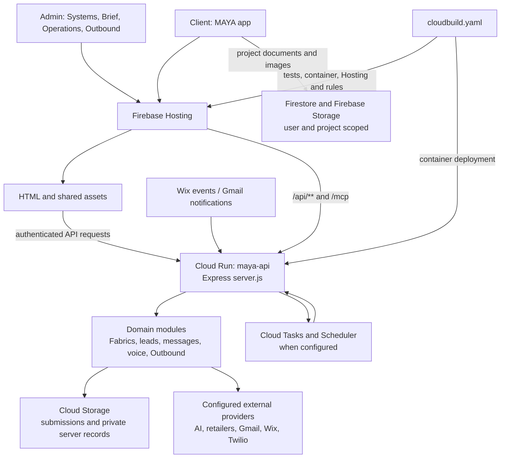
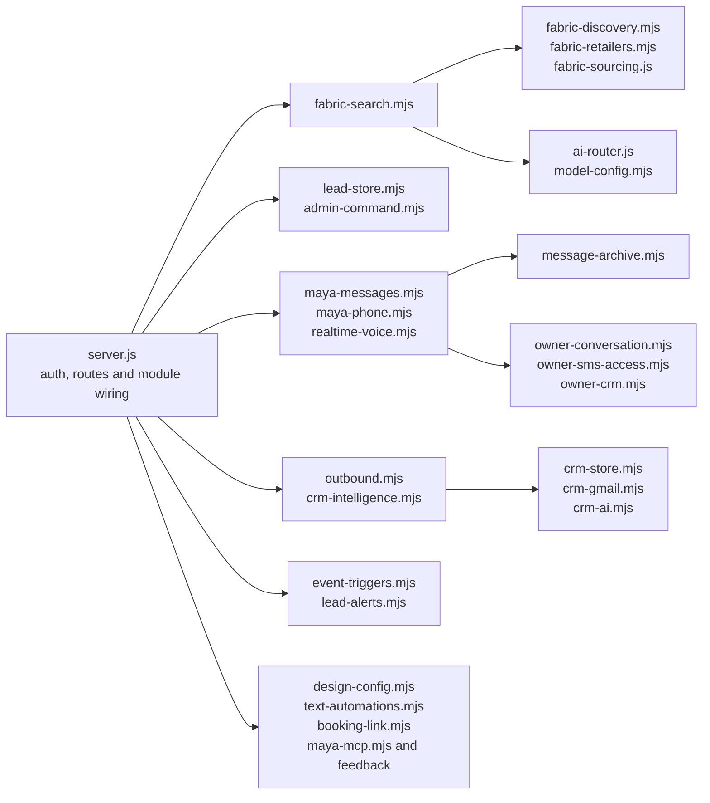

# MAYA architecture and file map

This is a map of the repository at the current checkout, not evidence of what is
currently deployed or which optional integrations are configured. The runtime
source, `docs/firebase.json` and the relevant runbooks remain authoritative.

## The whole system

`docs/firebase.json` serves the repository root, excludes `docs/`, `tests/` and
other private/development files, and rewrites `/api/**` and `/mcp` to Cloud Run.
Client project access uses Firebase security rules; Admin and server routes have
separate authentication and authorization checks. Provider configuration is not
proof that an integration is active or successfully delivering.

## Pages and their associated files

| Address and use | Page | Associated implementation |
|---|---|---|
| `/` — client moodboard and projects | `frontend/index.html` | Its embedded project UI and `projectStore`; `aesthetics/ui/voice-preparation.js`; shared design runtimes; Firebase project data and images. |
| `/status.html` — Admin Systems, Leads and Messages | `backend/status.html` | Embedded Admin logic; `aesthetics/ui/admin-systems.{js,css}`, `admin-design.js`, `lead-stage-menu.js`, `voice-preparation.js`; Admin APIs. |
| `/backend.html` — Brief | `backend/backend.html` | Embedded submission/dissection logic; shared `fabric-assistant.{js,css}` and `fabric-search-details.js`; embeds Operation Room. |
| `/operations.html` — Operation Room | `backend/operations.html` | Embedded garment/pattern logic; shared fabric assistant; saved-submission and AI APIs. Also runs inside the Brief. |
| `/outbound.html` — Outbound | `backend/outbound.html` | `backend/outbound.js`, `backend/outbound-priority.js`, and `/api/admin/outbound` routes. |
| Aesthetic Control — Admin design editor | `aesthetics/aesthetic-control.html` | `aesthetics/aesthetic-control/`; `aesthetics/ui/components/`; `presentation-runtime.js`, `pill-runtime.js`, `typography-controls.js`; `docs/server/design-config.mjs`. |
| Privacy, terms, deploy check | `backend/privacy.html`, `backend/terms.html`, `backend/verify.html` | Hosting rewrites and, for deploy verification, release and health endpoints. |

`aesthetics/` is served: it contains shared interface assets, imagery and design
controls. `docs/` is not served; it contains server source, rules and runbooks.
Several pages contain substantial inline JavaScript and CSS, so a page is not
just a template. The legacy Playground, Affiliates and standalone Marketing
addresses redirect; their old implementations are not active screens.

## Backend: responsibilities and associations

- **Fabrics:** the Brief and Operations share the browser assistant. The search
  service discovers allowed seller listings, verifies seller evidence and makes
  a bounded visual comparison. Completed results alone become product links.
  Historical lookbooks are private and scoped to an Admin account and submission.
- **Leads and communications:** the lead store, Messages, phone and owner tools
  have separate roles. History archives before trimming; reviewed sends, STOP
  handling and durable claims remain important boundaries. Event ingress and
  callback alerts require owner-configured infrastructure.
- **Outbound:** its browser view calls the account-scoped Outbound service. Gmail,
  storage and text-AI adapters are server-side. Sending remains an explicit,
  reviewed action.
- **AI and voice:** the server supplies model configuration, routing, proxy
  policy and realtime session preparation. Configuration and test fixtures do
  not establish live model quality or call delivery.

## Data and deployment boundaries

| Data or process | Location and boundary |
|---|---|
| Client projects and project images | Firestore and Firebase Storage under the authenticated user's project scope; see `firestore.rules`, `storage.rules`, and client `projectStore`. |
| Submission packages | Server-managed Cloud Storage submission prefixes; Admin APIs provide scoped access. Legacy migration and cleanup paths remain in place. |
| Fabric lookbooks | Private server storage under authenticated Admin account and submission; generation preconditions protect writes. |
| Outbound and mailbox information | Account-scoped server storage; mailbox secrets and cost records stay server-side. |
| Messages, lead history and design | Server-side stores and archives; `lead-store.mjs`, `message-archive.mjs` and `design-config.mjs` implement key persistence boundaries. |
| Deployment | `cloudbuild.yaml` runs release gates, builds `docs/server/Dockerfile`, deploys Cloud Run and Firebase Hosting/rules. Push is performed by Fromsa. |

This diagram intentionally groups modules and providers; it is not a complete
route list or a security audit. See `MODULE-BOUNDARIES.md`, `FABRIC-SEARCH.md`,
`MAYA-AI-ARCHITECTURE.md` and `AI-HANDOFF.md` for detailed contracts and current
limitations.
